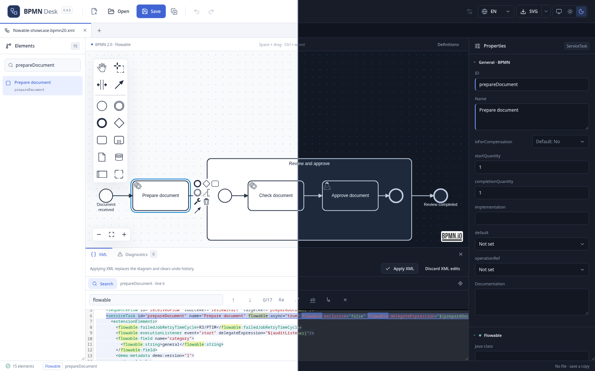
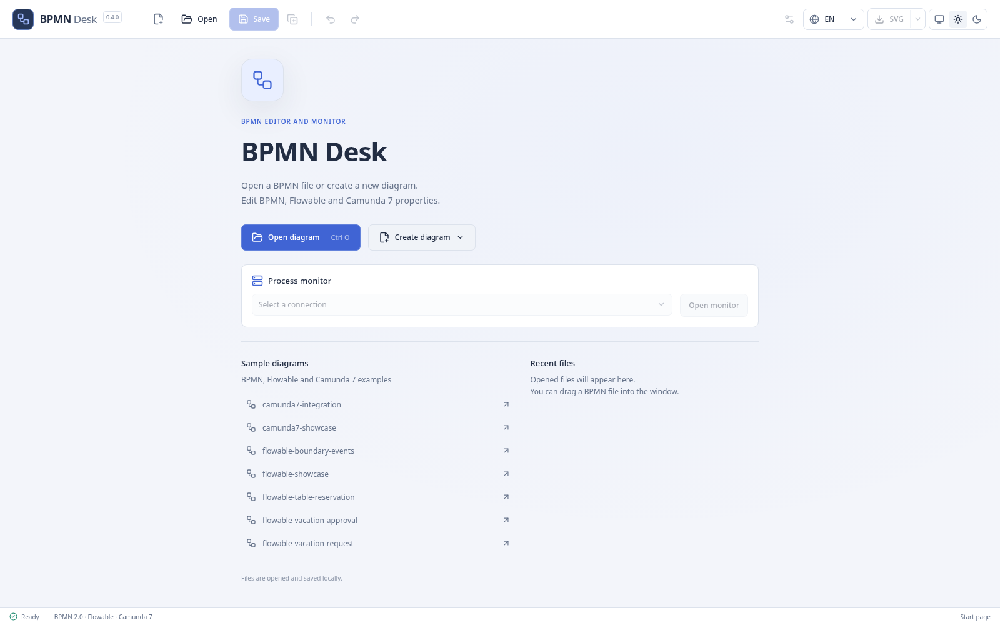
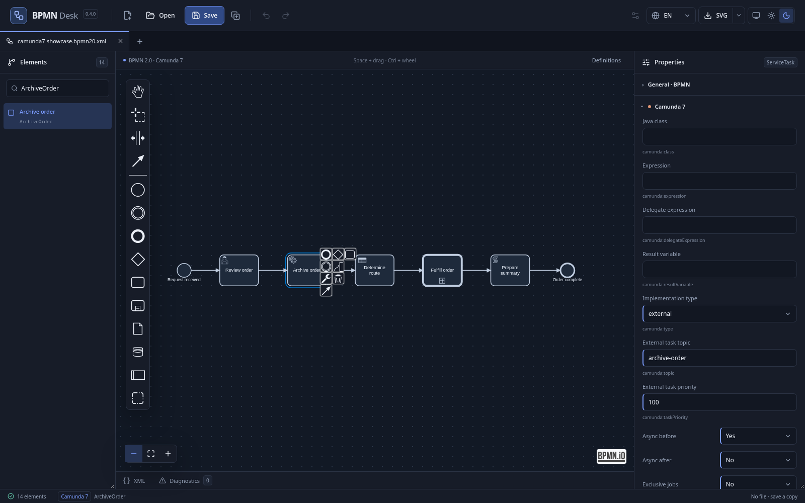
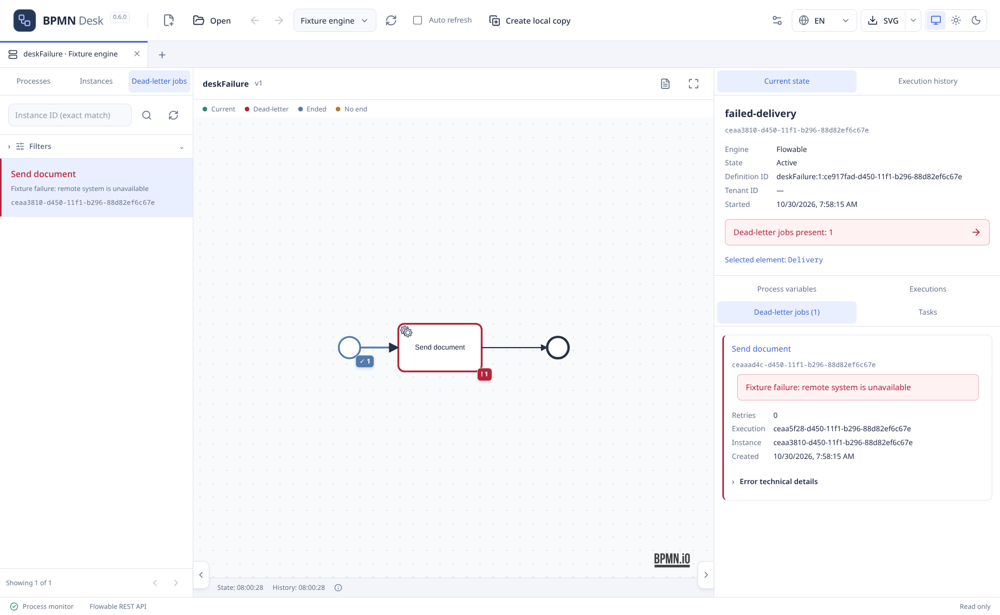
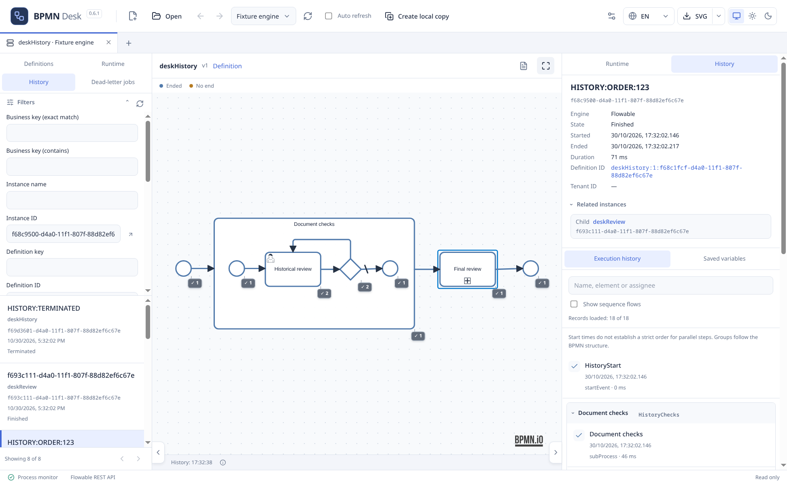

<div align="center">

# BPMN Desk

**Desktop BPMN editor and process monitor**

BPMN 2.0 · Flowable · Camunda 7<br>
Linux and Windows · local files · open source

[**Download**](https://github.com/michaelbrylevskii/bpmn-desk/releases/latest) · [Русский](README.ru.md) · [Documentation](docs/README.md)

</div>



<table>
<tr>
<td width="25%"><a href="docs/images/start.png"></a><br><sub>Start page</sub></td>
<td width="25%"><a href="docs/images/camunda.png"></a><br><sub>Camunda 7</sub></td>
<td width="25%"><a href="docs/images/monitor.png"></a><br><sub>Flowable monitor</sub></td>
<td width="25%"><a href="docs/images/history.png"></a><br><sub>Execution history</sub></td>
</tr>
</table>

## Features

- **Visual editor.** BPMN elements and connections, nested subprocesses, Flowable/Camunda 7 properties, custom attributes and extensions.
- **XML.** Syntax highlighting, search and replace, navigation to the selected element, extension editing and data preservation checks.
- **Workspace.** Independent tabs and undo/redo, recent files, drag-and-drop, CLI, draft recovery and external file change detection.
- **Flowable monitor.** Saved connections with configurable timeouts, process definitions with latest versions shown by default, instances, executions, tasks and variables. Separate Runtime and History catalogs with consistent collapsible filters and removable filter chips. Dead-letter jobs, stack traces, clear selection and bounded summaries with automatic loading and compact status tooltips. A persistent app-wide summary toggle controls loading and auto refresh. Summaries include separate Runtime and History counts, limited to 100 executions, 100 dead-letter jobs and 1000 historic activities; definition context is shared across instance and job catalogs. XML has syntax highlighting and read-only search.
- **Execution history.** Find finished or ongoing Flowable instances, inspect individual activity visits, loops, multi-instance tasks and called processes. The same diagram combines recorded visits and confirmed runtime positions; switch between Runtime and History in the right panel. Details and journal entries scroll together. Use the monitor toolbar to navigate back/forward through definitions, instances and jobs; destination tooltips show definition and instance details. Expand multiple journal entries without filtering the journal; select a diagram element to filter its visits.
- **Export.** SVG and PNG with white or transparent backgrounds; monitor exports include state markers.
- **Interface.** English and Russian, system/light/dark themes, interface and diagram zoom.

Local editing requires no account, server or file upload. Monitoring connects to a REST API of your choice and provides read-only access.

Copy elements between diagrams in the same window: select elements on the canvas, press `Ctrl+C`, switch to another diagram, click an empty area of its canvas to focus it, press `Ctrl+V`, and click to place. Undo belongs to the destination tab. The diagram clipboard does not transfer to other windows or external editors; external processes, forms, and resources are not copied automatically.

Drag diagram, monitor, and start-page tabs to reorder them. With a tab focused, use `Ctrl+Shift+←/→` to move it using the keyboard. Tab order lasts until the window closes.

## Engine support

| | Editing | Monitoring |
| --- | --- | --- |
| BPMN 2.0 | Standard elements and properties | — |
| Flowable | Task implementations, assignees, async/retry, listeners, forms, in/out | REST 7.2: state, variables, dead-letter jobs |
| Camunda 7 | External tasks, listeners, input/output, forms, connectors, DMN/call bindings, multi-instance | — |

Unknown extensions are accessible through attributes and XML. Engine detection uses namespace URIs; there is no automatic conversion between engines.

To set a default sequence flow, select an arrow → **General · BPMN** → **Default flow**, or select its source task/gateway and set `default`. Both controls update the standard `default="flowId"` on the source node, supported by Flowable and Camunda 7. The editor does not create or interpret `flowable:is-default-flow` as a replacement for `default`.

## Download

The [latest release](https://github.com/michaelbrylevskii/bpmn-desk/releases/latest) includes a **Linux x86_64 AppImage**, a **Windows x64 installer and portable app**, and `SHA256SUMS`. Node.js and Java are not required to run the app.

```bash
chmod +x BPMN-Desk-*.AppImage
./BPMN-Desk-0.6.0-x86_64.AppImage
```

Without FUSE, use `--appimage-extract-and-run` as the first argument. Windows executables are unsigned; macOS is not available yet.

## Scope

- Visual editing requires BPMN DI; automatic layout is not provided. Saving may change XML formatting.
- The editor does not execute processes or provide deployment/retry actions. DMN/CMMN, Camunda 8/Zeebe and external form designers are not supported.
- History requires retained Flowable history and API access. Each snapshot loads up to 1000 activity records, 100 children and 100 saved variables; incomplete counts use N+ to mean at least N. Saved variables are latest values, not values at a selected step. Snapshots are not transactional; route arrows require recorded sequence flows. Camunda 7 runtime is not supported. [API details](docs/runtime-monitor.md).
- Back/forward navigation keeps up to 100 destinations per direction in each monitor, in memory only. Changing its connection resets navigation. Mouse side buttons use Electron system commands; macOS support is pending.
- Local files are limited to 20 MB. PNG is limited to 16,384 px per side and 32 million pixels; SVG is available for larger diagrams.

## Development and license

Electron · React · TypeScript · bpmn-js · CodeMirror. [Development and checks](docs/development.md) · [Architecture](docs/architecture.md) · [Release validation](docs/validation.md). Project documentation is in Russian.

Code: [MIT](LICENSE). Seven bundled examples have explicit [provenance and licenses](examples/provenance.json); user diagrams are supported as [local test packs](docs/local-schema-packs.md) outside Git and distributions. [Third-party notices](THIRD_PARTY_NOTICES.md).
