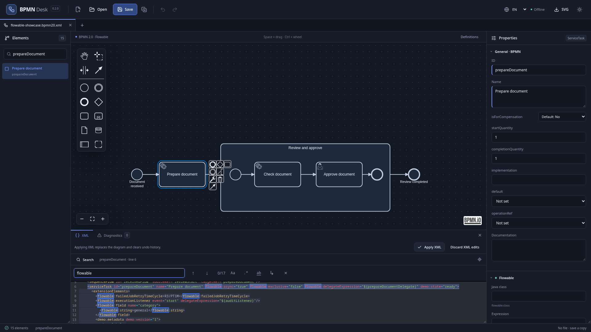

# BPMN Desk

Локальный просмотрщик и редактор BPMN 2.0 с поддержкой расширений Flowable и Camunda 7. Редактирование файлов не требует учётной записи, сервера или загрузки схем в облако. Дополнительно можно подключиться к REST API Flowable для просмотра состояния процессов.

Доступен для Linux x86_64 в формате AppImage и Windows x64 в виде установщика и portable-приложения. Английский и русский интерфейс, системная, светлая и тёмная темы.

[Скачать приложение](https://github.com/michaelbrylevskii/bpmn-desk/releases/latest) · [Результаты проверок](docs/validation.md)



[Светлая тема](docs/images/editor-light.png) · [Русский интерфейс](docs/images/editor-russian.png)

## Возможности

- Документы и несколько независимых мониторов во вкладках, открытие и перетаскивание BPMN/XML, недавние файлы и открытие схем из командной строки.
- Визуальное редактирование задач, событий, связей, шлюзов, пулов и подпроцессов средствами bpmn-js; независимая история отмены и повтора для каждого документа.
- Поиск элементов по имени и ID, масштабирование схемы и интерфейса, список элементов и панель свойств с индикацией явно заданных значений.
- Общие BPMN-свойства, условия и таймеры, определения сообщений, ошибок и сигналов, а также свойства и вложенные расширения обоих движков.
- Дополнительные атрибуты с пространствами имён и произвольные `extensionElements`, включая пользовательские расширения и метаданные моделировщиков.
- XML-редактор с поиском, заменой и переходом к выбранному элементу схемы; отдельное редактирование XML расширений.
- Экспорт всей схемы в SVG или PNG с белым либо прозрачным фоном.
- Диагностика схемы и исправление пересечений граничных событий с возможностью отмены.
- Восстановление несохранённой работы, атомарное сохранение и обнаружение внешних изменений файла.
- Сохранённые подключения к Flowable, просмотр развёрнутых версий и запущенных экземпляров, executions, задач и переменных; dead-letter jobs с подсветкой на схеме и stacktrace.

## Поддерживаемые схемы

«Новая вкладка» доступна через кнопку «+» или Ctrl+N из любого документа и монитора. Здесь можно открыть пример или недавний файл, создать схему либо монитор. При создании документа можно выбрать BPMN 2.0, Flowable или Camunda 7. Профиль открываемой схемы определяется по URI пространств имён; конкретные XML-префиксы могут отличаться.

| Профиль | Свойства и расширения в панели редактора |
| --- | --- |
| BPMN 2.0 | Стандартные свойства элементов, условия, таймеры, сообщения, ошибки, сигналы и скрипты. |
| Flowable | Реализации задач, исполнители и кандидаты, async/exclusive, retry, listeners и fields, formProperty, параметры вызова in/out. |
| Camunda 7 | Реализации задач и external tasks, исполнители и кандидаты, async/exclusive, retry, listeners и fields, input/output с map/list/script, formData, connectors, in/out, привязки DMN и вызываемых процессов, события и multi-instance. |

Для расширений без специализированной формы доступны дополнительные атрибуты и XML расширений. Изменения свойств проходят через общую историю команд. Цвет точки в заголовке свойств обозначает профиль: зелёный — Flowable, оранжевый — Camunda 7.

Если схема использует расширения обоих движков, редактор показывает обе группы свойств и предупреждение. Автоматической конвертации между движками нет. Редактор не выполняет процессы и не заменяет проверку схемы в целевом движке.

## Состояние процессов

В «Новой вкладке» можно создать локальную схему или открыть монитор Flowable с сохранённым подключением. Пункт «Новое подключение» находится внизу списка; укажи адрес REST API и авторизацию none, Basic или Bearer. Проверить подключение можно до сохранения. Несколько мониторов работают независимо, каждый со своим сервером, экземпляром и положением холста. Секреты сохраняются по выбору через защищённое хранилище ОС или используются только до закрытия приложения.

Выбери определение или экземпляр, чтобы увидеть точную версию схемы. Активные элементы выделены зелёным, элементы с dead-letter jobs — красным. Панель показывает executions, user tasks и переменные процесса; локальные переменные execution и stacktrace загружаются по запросу. Для поиска ошибок есть отдельный список dead-letter jobs. Каталоги поддерживают раскрываемые фильтры, сортировку и размер страницы. Есть переходы к родителю и дочерним экземплярам. В верхнем тулбаре доступны управление подключениями, ручное обновление и автообновление каждые 5 секунд; экспорт SVG/PNG сохраняет метки состояния.

Для выбранной версии доступна сводка по кнопке: два запроса, до 100 executions и 100 dead-letter jobs, общий таймаут 8 секунд. Бейджи считают разные экземпляры у элемента; неполные значения обозначены `≥ N`, ошибки доступа показаны явно. Фильтр последних версий работает на сервере. Сводка автоматически не обновляется; полного агрегата по всем экземплярам и фильтров «только с экземплярами/ошибками» нет. Метка в списке экземпляров показывает приостановку, а не выполнение прямо сейчас.

Монитор читает состояние сервера. Для изменения схемы можно создать локальную копию; административных действий нет. Локальный редактор работает независимо от подключения. Runtime-адаптер Camunda 7 пока не реализован. [Подключения, работа и ограничения](docs/runtime-monitor.md).

## Установка и запуск

Готовые файлы и `SHA256SUMS` доступны на [странице релизов](https://github.com/michaelbrylevskii/bpmn-desk/releases/latest). Node.js и Java для запуска приложения не нужны.

### Linux

Скачай AppImage, разреши выполнение и запусти файл:

```bash
chmod +x BPMN-Desk-0.3.0-x86_64.AppImage
./BPMN-Desk-0.3.0-x86_64.AppImage
# Сразу открыть схему:
./BPMN-Desk-0.3.0-x86_64.AppImage /путь/к/процессу.bpmn20.xml
```

AppImage использует FUSE для доступа к файлам внутри образа. Если FUSE недоступен, можно запустить приложение с распаковкой; `--appimage-extract-and-run` должен быть первым аргументом:

```bash
./BPMN-Desk-0.3.0-x86_64.AppImage --appimage-extract-and-run
```

### Windows

- `BPMN-Desk-0.3.0-x64-Setup.exe` — установщик для текущего пользователя с выбором каталога и языка установки.
- `BPMN-Desk-0.3.0-x64-Portable.exe` — запуск без установки.

Оба варианта содержат редактор и встроенные примеры. Portable сохраняет настройки в обычном пользовательском профиле Electron. Windows-сборки не подписаны сертификатом издателя. Подробности сборки и проверки — в [руководстве для Windows](docs/windows.md).

## Работа со схемой

Создай документ с нужным профилем или открой существующий файл. Выбери элемент на холсте или в списке слева, чтобы увидеть его свойства. Изменения полей применяются при потере фокуса; заданные значения отмечены акцентной боковой гранью.

Для дополнительного атрибута укажи `prefix:name`, значение и URI пространства имён. Пустое значение удаляет атрибут. В разделе «XML расширений» можно изменить вложенные расширения элемента; применение отменяется обычным undo. Отступы блока выравниваются для чтения, а текст, скрипты, CDATA и значимые пробелы сохраняются.

Нижняя вкладка XML содержит исходник всей схемы. Кнопка Search / Поиск открывает и закрывает поиск, сохраняя запрос; Ctrl+F открывает или фокусирует его, Escape закрывает. Доступны замена, учёт регистра, регулярные выражения и поиск целых слов. Выбор элемента на схеме прокручивает XML к его тегу и подсвечивает границы.

Правки полного XML нужно явно применить или отменить перед сохранением. Применение начинает новую историю команд. При ошибке текущая диаграмма сохраняется, а уведомление показывает причину отказа и раскрываемые подробности парсера. Если восстановление после ошибки визуального импорта потребовало перезагрузки модели, история команд может сброситься.

Кнопка экспорта повторяет выбранный вариант; стрелка рядом открывает меню SVG и PNG. Изображение содержит всю схему в светлой палитре с сохранением явных DI-цветов. PNG создаётся в масштабе 2×. Экспорт изображения не сохраняет изменения BPMN.

Если граничные события перекрывают друг друга или маркер подпроцесса, в свойствах и диагностике доступна команда «Разнести события». Она меняет размещение только после нажатия; Ctrl+Z отменяет весь набор перемещений.

Если файл изменён другой программой, обычное сохранение останавливается: можно переоткрыть файл или выбрать «Сохранить как». Восстановленные после перезапуска документы также сохраняются через «Сохранить как».

### Интерфейс и сочетания клавиш

Язык переключается через меню Language / Язык или кнопку EN/RU на панели инструментов. Английский используется по умолчанию. Три кнопки темы задают системный режим, светлую или тёмную тему; системный режим реагирует на настройки ОС без перезапуска. Язык, тема и масштаб сохраняются между запусками.

Верхнее системное меню скрыто; нажми Alt, чтобы показать его. Сочетания клавиш работают и при скрытом меню.

| Действие | Сочетание |
| --- | --- |
| Создать схему с выбором профиля | Ctrl+N |
| Найти текст в панели XML | Ctrl+F |
| Увеличить / уменьшить масштаб интерфейса | `Ctrl++` (или `Ctrl+=`) / `Ctrl+-` |
| Сбросить масштаб интерфейса | Ctrl+0 |
| Вписать диаграмму в холст | Ctrl+Shift+0 |
| Отменить изменение | Ctrl+Z |

Кнопки на холсте меняют только масштаб схемы. Настройки интерфейса не меняют BPMN. Уведомления закрываются автоматически; наведение, фокус и открытые подробности приостанавливают таймер, а после взаимодействия действует задержка перед его возобновлением.

## Ограничения

- Linux x86_64 и Windows x64 проходят нативные сборки и UI-проверки в CI, включая запуск готового приложения. Проверка Windows EXE не заменяет ручную приёмку установщика и ассоциаций файлов. macOS пока не поставляется.
- Для визуального редактирования требуется BPMN DI с координатами. Для схем без DI доступен XML; общей автоматической раскладки нет.
- Поддерживается UTF-8, включая BOM. Файлы с неверными байтами отклоняются.
- Сохранение через moddle может менять форматирование XML, префиксы и представление CDATA. Побайтовое сохранение исходника не гарантируется.
- Неизвестные пространства имён сохраняются, если их содержимое поддерживается моделью XML. Конструкции, которые невозможно сохранить, блокируют импорт или сохранение; произвольный mixed content и неизвестные неименованные BPMN-атрибуты не поддерживаются в общем случае.
- Стандартное значение BPMN, совпадающее с умолчанием, может быть опущено при экспорте и показано как умолчание после повторного открытия.
- PNG ограничен стороной 16 384 px, площадью 32 млн пикселей и файлом 20 МБ. Для крупных схем доступен SVG.
- Процессы, expressions, scripts и Java delegates не выполняются; deployment не предусмотрен. Прикладную корректность конфигурации нужно проверять в целевом движке.
- Монитор требует доступный Flowable REST API с правами чтения repository/runtime/management. Завершённые экземпляры и история не включены; бинарные и сериализованные Java-переменные автоматически не загружаются. Снимок состояния собирается несколькими запросами и может меняться во время чтения.
- Camunda 7 ориентирована на спецификацию 7.24. Camunda 8/Zeebe, редактирование DMN/CMMN и внешних файлов форм не поддерживаются; ссылки на ресурсы сохраняются.
- Восстановление сессии ограничено объёмом localStorage; ошибки восстановления показываются пользователю.
- Совместное редактирование, синхронизация Git и облачные сервисы не предусмотрены.

## Разработка

Стек: Electron, React, TypeScript, bpmn-js и CodeMirror. Рекомендуется Node.js 24 и npm; поддерживаемые версии Node.js указаны в `package.json`. JDK 17+ и Maven нужны только для дополнительных проверок моделей Flowable и Camunda 7.

```bash
npm ci
npm run setup:electron
npm run dev
```

`npm run dev:web` запускает браузерный preview на `http://127.0.0.1:5173`. В нём сохранение скачивает файл; сохранение по пути и недавние документы доступны в desktop-приложении.

### Проверки и сборка

```bash
npm run check                    # strict TypeScript, ESLint, unit/roundtrip
npm run setup:e2e                # установить тестовый Chromium
npm run package:linux            # собрать AppImage в release/
npm run test:e2e                 # UI, Electron, CLI, native save, AppImage
npm run test:runtime             # независимый Flowable/H2 и Electron: экземпляры, переменные, dead-letter
npm run validate:flowable        # официальный конвертер Flowable 7.2
npm run validate:camunda         # официальная BPMN Model API Camunda 7.24
npm run package:windows          # Windows x64: NSIS + portable; Windows или Linux с Wine
npm run package:windows:docker   # Linux: сборка Windows через Docker с Wine
npm run capture:screenshots     # обновить скриншоты на встроенной схеме
```

Проверки движков используют экспорты встроенных схем и изменённых моделей, полученные UI-тестами. Они дополняют проверки редактора сравнением моделей через официальные библиотеки; Java не входит в приложение. AppImage-тест пропускается, если артефакт ещё не собран или тесты выполняются на другой ОС.

GitHub Actions выполняет проверки и нативные сборки на Linux и Windows. После успешного прогона тег `v<версия>` публикует релиз с тремя дистрибутивами и `SHA256SUMS`. Пользовательские пакеты в CI не подключаются. Подробности — в [руководстве по публикации](docs/publication.md).

## Примеры и лицензия

В приложении доступны пять примеров Flowable и два примера Camunda 7. Среди них три публичные схемы из проекта Flowable и четыре оригинальные демонстрационные схемы BPMN Desk. Источники, ревизии, SHA-256 и лицензии указаны в [examples/provenance.json](examples/provenance.json).

Пользовательские схемы и их provenance можно подключить как дополнительный локальный тестовый пакет. Такие пакеты не включаются в Git, приложение или основной набор проверок: [инструкция](docs/local-schema-packs.md).

Код приложения распространяется по [MIT](LICENSE). Лицензии заимствованных схем и компонентов перечислены в [THIRD_PARTY_NOTICES.md](THIRD_PARTY_NOTICES.md).

## Документация

- [Требования и критерии приёмки](docs/requirements.md)
- [Архитектура и границы модулей](docs/architecture.md)
- [Архитектурные решения](docs/adr/README.md)
- [Подробная справка по расширениям Camunda 7](docs/camunda7.md)
- [Монитор Flowable и подключение к REST API](docs/runtime-monitor.md)
- [Сборка и проверка Windows](docs/windows.md)
- [Результаты проверок](docs/validation.md)
- [Сторонние компоненты](docs/third-party.md)
- [Дополнительные локальные схемы](docs/local-schema-packs.md)
- [Подготовка и публикация релиза](docs/publication.md)

## История версий

- [0.3.0](docs/releases/0.3.0.md) — поддержка Camunda 7, выбор профиля новой схемы, экспорт PNG, системная тема и улучшения XML-редактора.
- [0.2.0](docs/releases/0.2.0.md) — редактор BPMN и расширений Flowable, Linux AppImage и Windows installer/portable.
